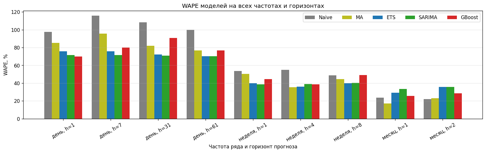

# Прогнозирование продаж: построение и оценка моделей временных рядов

Домашнее задание 2 по курсу «Прогнозирование временных рядов и обработка сигналов».

Продолжение ДЗ 1: тот же товар **85099B** (JUMBO BAG RED RETROSPOT) из датасета
[Online Retail](https://archive.ics.uci.edu/dataset/352/online+retail) и те же три ряда продаж
(штуки без возвратов): дневной по торговым дням, недельный и месячный. На них я сравниваю пять моделей
на заданных горизонтах. Весь ход работы, графики и выводы в `forecasting.ipynb`, функции в `src/`.

## Эксперименты

**Разбиение.** Данные делю по времени: в тест уходят последние 90 наблюдений дневного ряда, 16 недельного и
4 месячного (не меньше максимального горизонта). Оцениваю скользящей проверкой с расширяющимся окном: цель
из теста прогнозируется из точки на h шагов раньше по данным до неё, поэтому на всех горизонтах оцениваются
одни и те же цели. Что модели не видят будущего, проверено отдельным тестом.

**Горизонты** (шаг это один период ряда): день 1, 7, 31, 61; неделя 1, 4, 8; месяц 1, 2.

**Модели:** Naive и MA (ориентиры), ETS, SARIMA и градиентный бустинг sklearn с прямой стратегией по горизонтам (лаги, скользящие
среднее и std, отношение к среднему, день недели). Структура ETS и SARIMA выбирается по данным до первого
прогноза, то есть без теста.

**Метрики:** MAE и RMSE (в штуках), WAPE и MASE (безразмерные, для сравнения частот), ME (смещение).

## Результаты

Лучшие модели по MASE (для сравнения MASE наивного прогноза):

| Частота | Горизонт | Лучшая модель | MASE | WAPE, % | MASE Naive |
|---|---|---|---|---|---|
| день | 1 | GBoost | 0,95 | 69,76 | 1,33 |
| день | 7 | SARIMA | 0,98 | 71,40 | 1,58 |
| день | 31 | SARIMA | 0,97 | 70,76 | 1,48 |
| день | 61 | ETS (метрики ETS и SARIMA совпадают) | 0,96 | 70,23 | 1,37 |
| неделя | 1 | SARIMA | 1,25 | 38,72 | 1,73 |
| неделя | 4 | MA | 1,14 | 35,37 | 1,77 |
| неделя | 8 | ETS | 1,29 | 39,80 | 1,57 |
| месяц | 1 | MA | 0,82 | 17,17 | 1,13 |
| месяц | 2 | Naive | 1,06 | 22,10 | 1,06 |

Все метрики по всем моделям лежат в `results/metrics.csv`, прогнозы с фактом в `results/forecasts.csv`.


## Выводы

* Простые модели не хуже сложных. На дневных и недельных данных лидируют ETS и SARIMA (подбор оставил
  простейшие варианты: SES и среднее по обучению), бустинг выиграл только на дневном h=1 (0,95 против 0,98
  у SARIMA). На месячном ряду лучше Naive и MA: тест приходится на осенний рост, а модели, усредняющие всю
  историю, отстают.
* Ошибка с горизонтом почти не растёт (в дневном ряду у ETS и SARIMA MASE в пределах 0,96-1,04), зато растёт
  смещение: на недельных данных ME у ETS идёт от 222,18 к 303,92 и 381,14, то есть прогнозы занижают
  растущие продажи.
* WAPE у лучших моделей около 70 % на дневных данных, 35-40 % на недельных и 17-22 % на месячных: недельные и
  месячные суммы предсказываются заметно лучше дневных значений.



**Ограничения.** Крупные оптовые заказы не предсказывает никто (RMSE у ETS и SARIMA почти не зависит от
горизонта). Данных чуть больше года, поэтому годовую сезонность и тренд выучить нельзя. Тестовых прогнозов
мало (90, 16 и 4), значимость различий между близкими моделями я не проверяла. Бустинг не настраивался.

## Структура репозитория

```
.
├── forecasting.ipynb      # данные, модели, метрики, графики, выводы
├── src/
│   ├── ts_tools.py        # функции из ДЗ 1 (подготовка рядов)
│   └── forecast_tools.py  # модели, скользящая проверка, метрики, графики
├── data/                  # csv с рядами из ДЗ 1
├── results/               # forecasts.csv, metrics.csv
├── figures/               # графики из ноутбука
├── requirements.txt
└── README.md
```

Если в `data/` лежат csv из ДЗ 1, ноутбук прочитает их, иначе скачает датасет и соберёт ряды заново.
Выполнять сверху вниз.
