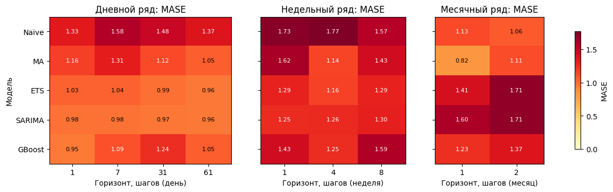
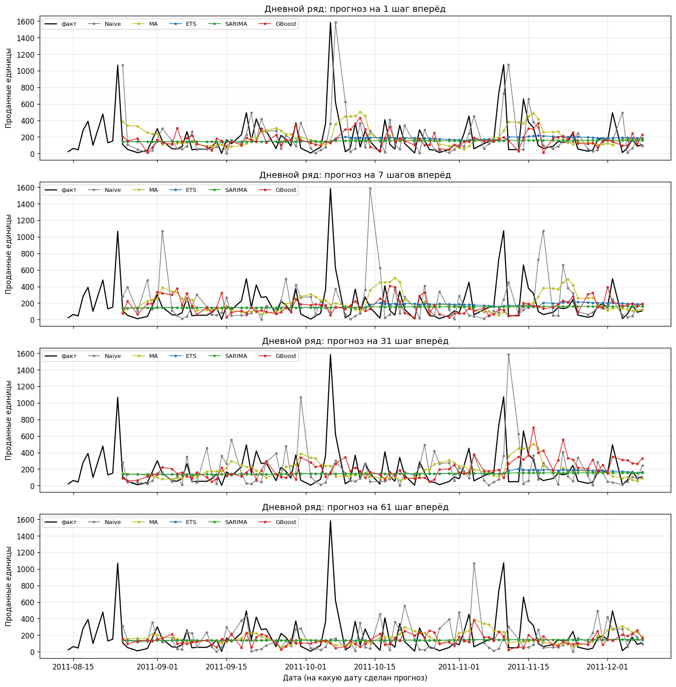
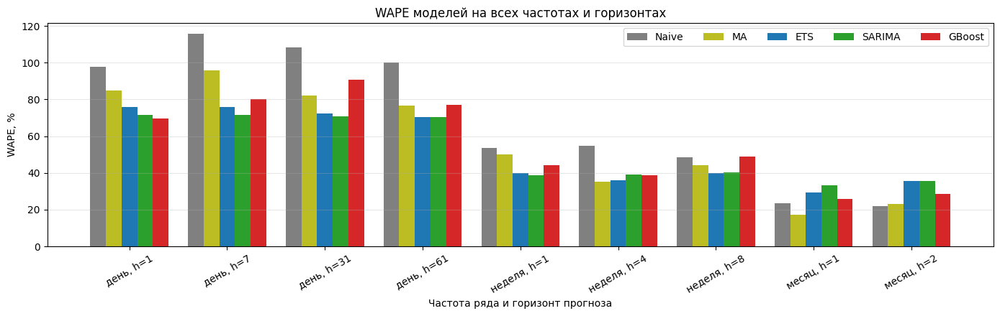

# Прогнозирование продаж: построение и оценка моделей временных рядов

Домашнее задание 2 по курсу «Прогнозирование временных рядов и обработка сигналов».

Продолжение ДЗ 1 (анализ и предобработка ряда): тот же товар **85099B** (JUMBO BAG RED RETROSPOT) из датасета
[Online Retail (UCI)](https://archive.ics.uci.edu/dataset/352/online+retail) и те же три ряда продаж
(в штуках, без возвратов): дневной на торговом календаре, недельный и месячный. На них я сравниваю
пять моделей на заданных горизонтах. Весь код и графики в `forecasting.ipynb`, функции в `src/`.

## Эксперименты

**Данные и разбиение.** Данные делю строго по времени. В тест уходят последние 90 наблюдений дневного ряда,
16 недельного и 4 месячного, это в каждом случае не меньше максимального горизонта. Оценка скользящая
(расширяющееся окно): для каждой даты из теста и каждого горизонта прогноз делается из точки на h шагов
раньше по данным до неё включительно. Благодаря этому на всех горизонтах оцениваются одни и те же цели, а
ошибки на разных горизонтах сравнимы. Что будущее не используется, проверено отдельным тестом: если заменить
все данные после точки прогноза мусором, прогноз не меняется.

**Горизонты** (шаг равен одному периоду ряда, в дневном ряду это торговый день):

| Частота | Горизонты |
|---|---|
| дневная | 1, 7, 31, 61 |
| недельная | 1, 4, 8 |
| месячная | 1, 2 |

**Модели.**

| Модель | Что это |
|---|---|
| Naive | последнее наблюдение (ориентир) |
| MA | среднее последних 6 дней, 4 недель или 2 месяцев (ориентир) |
| ETS | экспоненциальное сглаживание, конфигурацию (SES, Хольт, Хольт-Винтерс) выбираю по AICc |
| SARIMA | порядок по AICc, разность по тесту KPSS, в дневном ряду сезонная AR-часть с периодом 6 |
| GBoost | градиентный бустинг (sklearn), прямая стратегия по горизонтам, признаки: лаги, скользящие среднее и std, отношение к среднему, день недели |

Структура ETS и SARIMA выбирается один раз по данным до первого прогноза, то есть без доступа к тесту.
Бустинг предсказывает отклонение от скользящего среднего, потому что деревья не экстраполируют, а в ДЗ 1
было видно, что уровень ряда растёт.

**Метрики.** MAE и RMSE (в штуках), WAPE и MASE (безразмерные, для сравнения между частотами и горизонтами) и
ME (смещение). MAPE не использую из-за нулевых дней в дневном ряду. Подробное обоснование в ноутбуке, шаг 3.

## Результаты и выводы

Лучшие модели по MASE на каждой частоте и горизонте (для сравнения MASE наивного прогноза):

| Частота | Горизонт | Лучшая модель | MASE | WAPE, % | MASE Naive |
|---|---|---|---|---|---|
| день | 1 | GBoost | 0,95 | 69,76 | 1,33 |
| день | 7 | SARIMA | 0,98 | 71,40 | 1,58 |
| день | 31 | SARIMA | 0,97 | 70,76 | 1,48 |
| день | 61 | ETS (метрики ETS и SARIMA совпадают) | 0,96 | 70,23 | 1,37 |
| неделя | 1 | SARIMA | 1,25 | 38,72 | 1,73 |
| неделя | 4 | MA | 1,14 | 35,37 | 1,77 |
| неделя | 8 | ETS | 1,29 | 39,80 | 1,57 |
| месяц | 1 | MA | 0,82 | 17,17 | 1,13 |
| месяц | 2 | Naive | 1,06 | 22,10 | 1,06 |

Полная таблица со всеми метриками (MAE, RMSE, WAPE, MASE, ME) лежит в `results/metrics.csv`, прогнозы
вместе с фактом в `results/forecasts.csv`.



### Какие модели лучше

Простые модели уровня оказались не хуже сложных. На дневных и недельных данных лидировали ETS и SARIMA:
подбор по AICc оставил для них простейшие варианты (SES и SARIMA (0, 0, 0), то есть среднее по обучающей
части), поэтому их прогноз почти постоянный. Средний ранг по MASE у SARIMA 1,5 на дневных и 2,33 на
недельных данных, у ETS 2,0 и 1,67. Бустинг выиграл только на дневном h=1 (MASE 0,95 против 0,98 у SARIMA),
его средний ранг 3,0 на дневных, 3,67 на недельных и 3,0 на месячных данных. На месячном ряду лучшими были
Naive и MA (средний ранг 1,5), а ETS и SARIMA оказались последними: тест приходится на осенний рост продаж,
и модели, усредняющие всю историю, отстают от него. Между собой ближайшие модели различаются мало, а тестовых
прогнозов немного (90, 16 и 4), так что уверенно называть победителя можно не везде.



### Как качество зависит от горизонта и частоты

Заметного роста ошибки с горизонтом нет: у ETS и SARIMA в дневном ряду MASE остаётся около 0,96-1,04 на всех
горизонтах, у GBoost есть подъём до 1,24 на h=31, в недельном ряду ошибка колеблется без тренда. Рост ошибки
виден только в месячном ряду (например, у MA с 0,82 до 1,11), но там всего 4 тестовые точки. Зато заметно
растёт смещение: на недельных данных ME у ETS идёт от 222,18 к 303,92 и 381,14, то есть чем раньше сделан
прогноз, тем сильнее модель занижает растущие продажи. Безразмерная ошибка падает с укрупнением периода:
WAPE у лучших моделей около 70 % на дневных данных, 35-40 % на недельных и 17-22 % на месячных, то есть
недельные и месячные суммы предсказываются заметно лучше дневных значений.



### Ограничения и причины ошибок

* Крупные оптовые заказы делают дневной ряд непредсказуемым: ни одна модель не угадывает всплески, и RMSE у
  ETS и SARIMA почти одинаковая на всех горизонтах (235,71-237,80).
* Тест приходится на осень, когда уровень продаж выше, чем в обучении, и модели с длинной памятью занижают
  прогноз. Одного года данных не хватает, чтобы выучить годовую сезонность и тренд.
* Подбор по AICc выбрал вырожденные модели (SES и среднее), из-за чего ETS и SARIMA ведут себя почти
  одинаково, а в двух случаях (дневной h=61 и месячный h=2) совпали по метрикам.
* Мало тестовых данных (особенно 4 точки в месячном ряду), значимость различий между моделями я не проверяла.
* Гиперпараметры бустинга не подбирались, дополнительных признаков (праздники, цена) нет.
* Прогнозы на длинные горизонты делаются из более ранних точек, то есть по более короткой истории, а
  прогнозы обрезаны снизу нулём.

## Структура репозитория

```
.
├── forecasting.ipynb      # данные, модели, метрики, графики, выводы
├── src/
│   ├── ts_tools.py        # функции из ДЗ 1 (подготовка рядов)
│   └── forecast_tools.py  # модели, скользящая проверка, метрики, графики
├── data/                  # csv с рядами из ДЗ 1 (xlsx с транзакциями в git не попадает)
├── results/               # forecasts.csv (прогнозы и факт), metrics.csv (метрики)
├── figures/               # графики из ноутбука
├── requirements.txt
└── README.md
```

## Как запустить

```bash
python -m venv .venv
source .venv/bin/activate        # Windows: .venv\Scripts\activate
pip install -r requirements.txt
jupyter notebook forecasting.ipynb
```

Если в `data/` лежат csv из ДЗ 1 (`sales_85099B_daily.csv`, `sales_85099B_weekly.csv`,
`sales_85099B_monthly.csv`), ноутбук прочитает их. Если нет, он скачает датасет и соберёт ряды заново теми
же функциями. Ноутбук выполняется сверху вниз, полный запуск занимает несколько минут.
